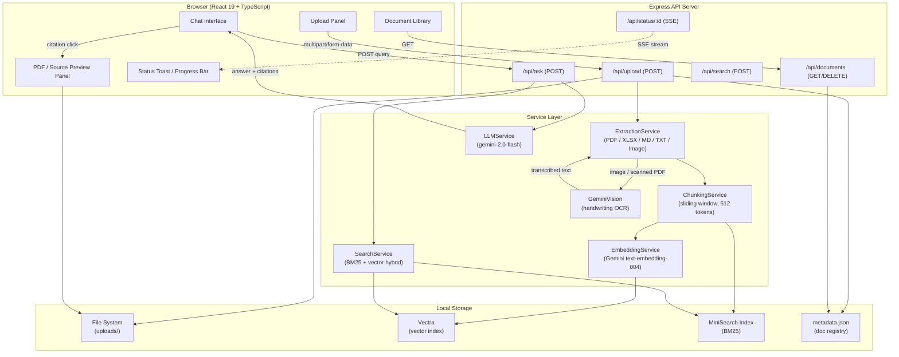
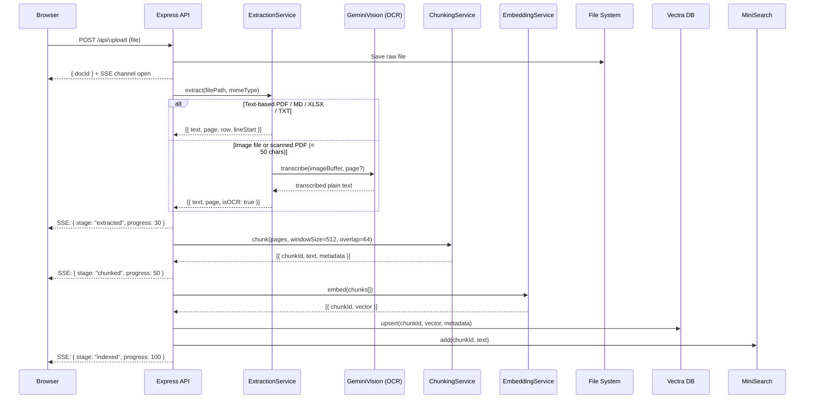
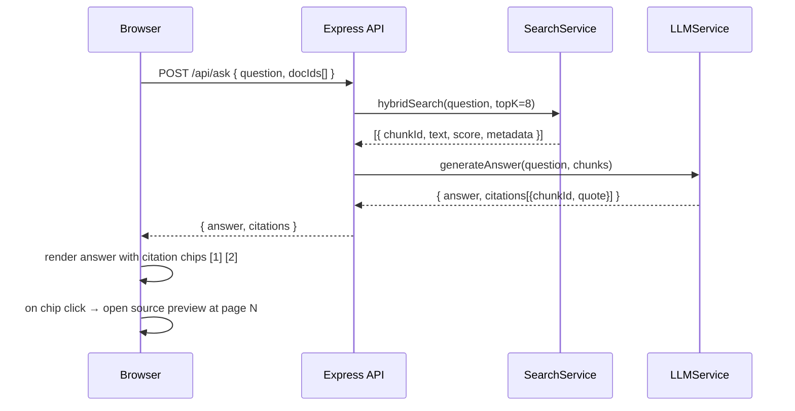

# Architecture Design — Software / System Architecture
> **How the components fit together, data flows, APIs, and services**

---

## Component Diagram



---

## Data Flow — Upload & Indexing



---

## Data Flow — Q&A



---

## Chunk Metadata Schema

```typescript
interface ChunkMetadata {
  docId:       string;   // UUID
  filename:    string;
  mimeType:    string;
  chunkIndex:  number;
  isOCR?:      boolean;  // true when text came from Gemini Vision
  // Source location (filled per parser)
  page?:       number;   // PDF pages (1-indexed) or image sequence number
  sheet?:      string;   // Excel sheet name
  rowStart?:   number;   // Excel / CSV row
  lineStart?:  number;   // Markdown / TXT line
  charStart:   number;   // absolute char offset in extracted text
  charEnd:     number;
}
```

---

## API Contract

| Method | Path | Body | Response |
|--------|------|------|----------|
| `POST` | `/api/upload` | `multipart: file` | `{ docId, filename, status }` |
| `GET` | `/api/status/:docId` | — | SSE stream `{ stage, progress, error? }` |
| `GET` | `/api/documents` | — | `Document[]` |
| `DELETE` | `/api/documents/:docId` | — | `{ ok }` |
| `POST` | `/api/ask` | `{ question, docIds[] }` | `{ answer, citations[] }` |
| `GET` | `/api/file/:docId` | — | raw file (for PDF / image preview) |
