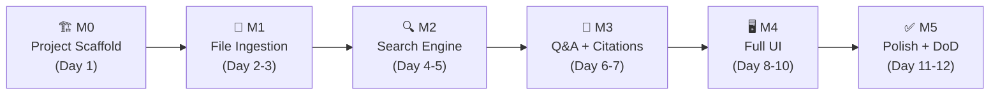
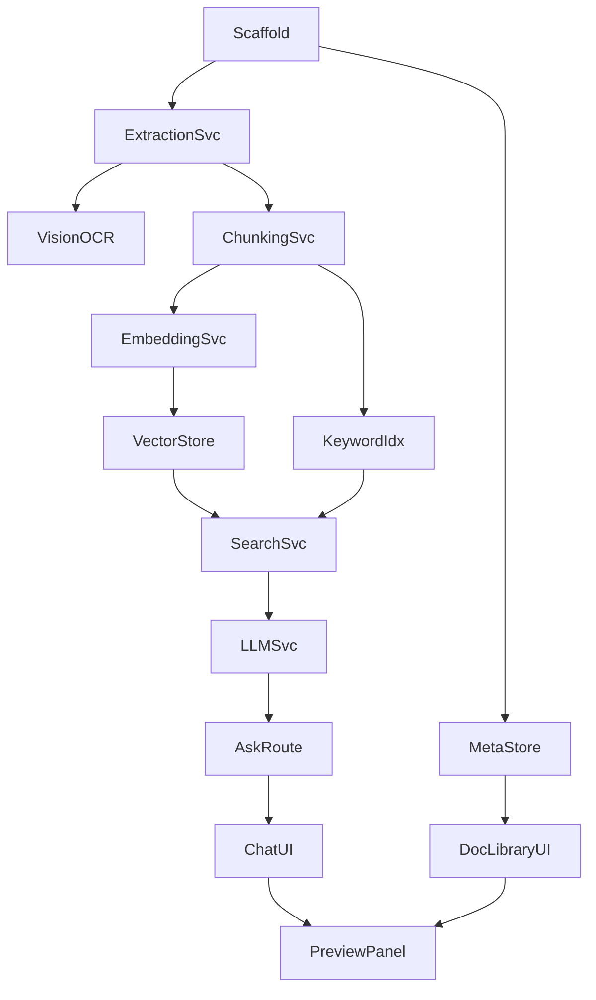

# Implementation Plan — Development Roadmap
> **The order of development, milestones, and tasks**

---

## Milestones



---

## Task Breakdown

### M0 — Project Scaffold (Day 1)
- [ ] `pnpm create vite frontend --template react-ts`
- [ ] `pnpm init` in `backend/`; add Express, TypeScript, `ts-node-dev`
- [ ] Configure Tailwind CSS in frontend
- [ ] Root `package.json` with `concurrently` to run both servers with single `pnpm dev`
- [ ] `backend/.env.example` with all required keys and comments
- [ ] `.gitignore` covering `uploads/`, `data/`, `.env`, `node_modules/`
- [ ] Root `README.md` with full setup instructions

### M1 — File Ingestion Pipeline (Day 2–3)
- [ ] `multer` upload route → save raw file to `uploads/`
- [ ] `MetadataStore` JSON registry (create, read, update, delete)
- [ ] SSE `/api/status/:docId` endpoint
- [ ] `ExtractionService` — text-based PDF parser (`pdf-parse`)
- [ ] `ExtractionService` — XLSX parser (SheetJS)
- [ ] `ExtractionService` — Markdown parser (`remark` + `strip-markdown`)
- [ ] `ExtractionService` — plain text parser (readline)
- [ ] `ExtractionService` — image parser (Gemini Vision OCR)
- [ ] `ExtractionService` — scanned PDF detection + Vision fallback
- [ ] `ChunkingService` with sliding window (512 tokens, 64 overlap)
- [ ] Unit tests: each parser returns correct `Page[]` with metadata

### M2 — Search Engine (Day 4–5)
- [ ] `VectorStore` (Vectra) — `upsert(chunkId, vector, metadata)` and `query(vector, topK, filter)`
- [ ] `EmbeddingService` — batch embed via `text-embedding-004`
- [ ] `KeywordIndex` (MiniSearch) — `add(chunk)` and `search(query, docIds)`
- [ ] `SearchService` — hybrid fusion with configurable α weight
- [ ] Wire ingestion pipeline: chunks → embed → upsert VDB + add MS
- [ ] Integration test: upload doc → query → top chunk contains answer keyword

### M3 — Q&A + Citations (Day 6–7)
- [ ] `LLMService` with citation-enforcing system prompt
- [ ] `/api/ask` route: search → LLM → parse `[N]` tags → map to `ChunkMetadata`
- [ ] Citation response schema: `{ answer, citations[{ index, chunkId, quote, metadata }] }`
- [ ] Guard: if no relevant chunks found → return graceful "no information" response
- [ ] E2E smoke test: `POST /api/ask` → answer contains `[1]` citing correct page

### M4 — Full UI (Day 8–10)
- [ ] Zustand store with all state slices and actions
- [ ] `useSSE` hook — consume `/api/status/:docId` stream
- [ ] `useUpload` hook — multipart POST + subscribe to SSE progress
- [ ] `useDocuments` hook — fetch list, optimistic delete
- [ ] `useChat` hook — POST question, stream answer into messages
- [ ] `UploadDropzone` — drag-and-drop with accepted MIME types
- [ ] `DocumentCard` — status chip (✅ ⏳ ❌), OCR badge 🖼, progress bar
- [ ] `DocumentContextMenu` — Re-index / Download / Delete with confirm dialog
- [ ] `DocScopeFilter` — pill selector above input bar
- [ ] `AssistantBubble` — render markdown + inline `CitationChip` components
- [ ] `CitationChip` — click → `setPreview(chunk)` in store
- [ ] `PDFViewer` — `react-pdf` with lazy page loading, scroll-to-page on citation
- [ ] `ImageViewer` — renders PNG/JPG source file for OCR'd uploads
- [ ] `TextHighlighter` — highlights cited quote within preview
- [ ] `SourceMetaBadge` — "stats101.pdf · Page 14 · OCR 🖼"

### M5 — Polish & Definition of Done (Day 11–12)
- [ ] Error states: ❌ card tooltip, `StatusToast` for API failures
- [ ] Loading skeletons for document list and chat messages
- [ ] Keyboard accessibility: Tab order, ARIA labels, focus management
- [ ] Empty states: no documents yet, no messages yet
- [ ] Final DoD verification checklist (see below)

---

## Dependency Graph



---

## Definition of Done Checklist

> [!IMPORTANT]
> The project is **done** when ALL items below pass without manual workarounds.

| # | Test | Expected result |
|---|------|-----------------|
| 1 | Upload a 20-page digital PDF | ✅ status within 30 s; all 20 pages indexed |
| 2 | Upload a scanned (image-only) PDF | Auto-detects OCR needed; ✅ with 🖼 badge |
| 3 | Upload a JPG of handwritten notes | Handwriting transcribed; chunks searchable |
| 4 | Upload an `.xlsx` with 3 sheets | All 3 sheets extracted; row metadata present |
| 5 | Upload a `.md` file | Line numbers preserved in chunk metadata |
| 6 | Ask a question answered on page 7 of a PDF | `[1]` chip appears; click opens PDF at page 7 |
| 7 | Ask a question answered in a handwritten image | `[1]` chip with 🖼 badge; click shows image + highlight |
| 8 | Ask something not in any document | "I don't have information about that" — no hallucination |
| 9 | Upload a corrupted / unsupported file | ❌ status with descriptive error tooltip |
| 10 | Delete a document | Removed from library; search returns no chunks for it |

---

## Verification Commands

```bash
# Backend — unit tests (ExtractionService, ChunkingService, SearchService)
cd backend && pnpm test

# Frontend — component tests (Vitest + Testing Library)
cd frontend && pnpm test

# E2E smoke test (uploads fixture PDF, asks question, checks citation)
cd backend && pnpm test:e2e

# Start full app for manual DoD walkthrough
pnpm dev   # from repo root (runs both servers via concurrently)
```

---

## Decisions Log

| # | Question | Decision |
|---|----------|----------|
| Q1 | LLM Provider | **Google Gemini API** (`gemini-2.0-flash`). Free tier. API key in `.env`. Swappable to Ollama via `LLM_PROVIDER=ollama`. |
| Q2 | Auth | **None for v1.** Open access, single-user, local. |
| Q3 | PDF Preview | **`react-pdf`** with lazy page rendering. |
| Q4 | Deployment | **Local dev only.** Single `pnpm dev` at root via `concurrently`. |
| Q5 | Handwriting OCR | **Gemini Vision** (`gemini-2.0-flash` multimodal). Same API key, zero extra cost. Scanned PDFs auto-detected (< 50 chars) and rerouted. |
