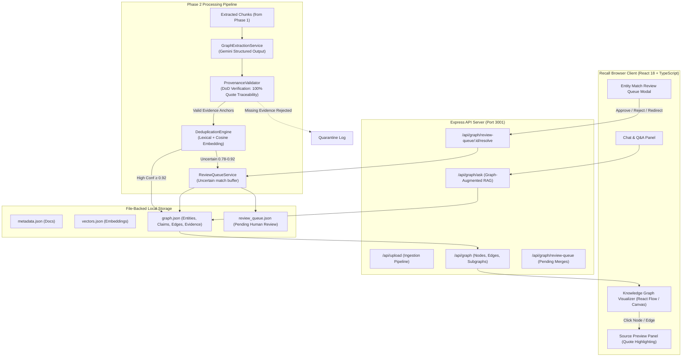
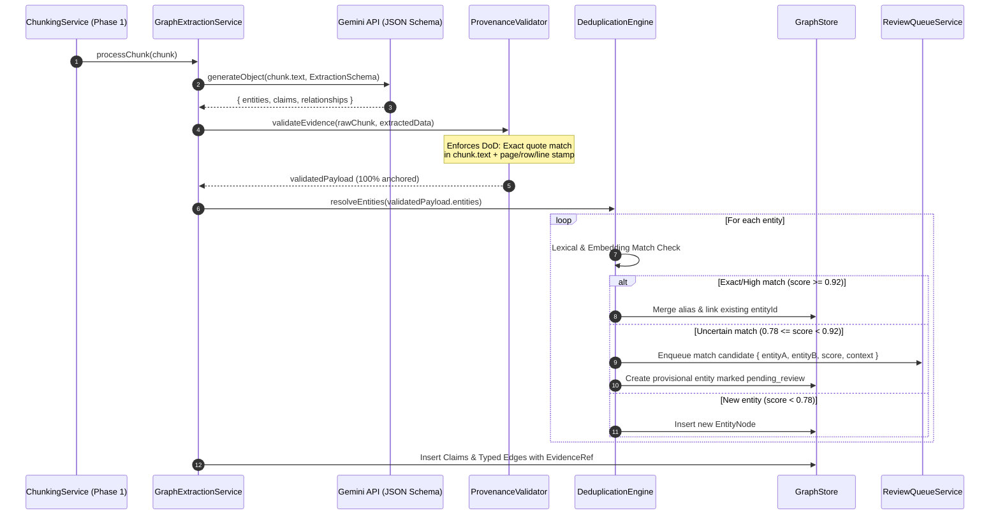

# Architecture Design — Software / System Architecture (Phase 2)
> **How Knowledge Graph, Entity Resolution, Provenance, and Review Systems fit into Recall**

---

## Component Diagram



---

## Detailed Ingestion & Extraction Sequence



---

## Data Schema & Storage Architecture

### 1. `EntityNode`
```typescript
export type EntityType = 
  | 'Concept' 
  | 'Method' 
  | 'Formula' 
  | 'Theorem' 
  | 'Property' 
  | 'Dataset' 
  | 'Person';

export interface EntityNode {
  id: string;                      // Canonical UUID
  name: string;                    // Normalized canonical name
  type: EntityType;
  description?: string;
  aliases: string[];               // e.g. ["SVD", "Singular Value Decomposition"]
  embedding?: number[];            // 768-dim float for deduplication lookup
  status: 'active' | 'pending_review' | 'merged';
  mergedIntoId?: string;           // Pointer if merged
  evidence: EvidenceRef[];         // References to passages defining/mentioning entity
  createdAt: number;
  updatedAt: number;
}
```

### 2. `ClaimNode`
```typescript
export type ClaimModality = 'Fact' | 'Definition' | 'Hypothesis' | 'Rule';

export interface ClaimNode {
  id: string;
  subjectEntityId: string;         // Primary subject entity
  claimText: string;               // Normalized claim statement
  modality: ClaimModality;
  confidence: number;              // 0.0 to 1.0
  evidence: EvidenceRef;           // DoD: Mandatory single source passage
  createdAt: number;
}
```

### 3. `RelationshipEdge`
```typescript
export type RelationType =
  | 'DEFINES'
  | 'IS_A'
  | 'PART_OF'
  | 'PREREQUISITE_FOR'
  | 'CAUSES'
  | 'USES'
  | 'CONTRADICTS'
  | 'PROVES'
  | 'EQUIVALENT_TO'
  | 'RELATED_TO';

export interface RelationshipEdge {
  id: string;                      // Edge UUID
  sourceId: string;                // Source EntityNode ID
  targetId: string;                // Target EntityNode ID
  relationType: RelationType;
  description: string;             // Descriptive sentence of the relation
  confidence: number;
  evidence: EvidenceRef;           // DoD: Verifiable link to passage
  claimId?: string;                // Optional link to supporting ClaimNode
  createdAt: number;
}
```

### 4. `EvidenceRef` (The Definition of Done Anchor)
```typescript
export interface EvidenceRef {
  docId: string;
  chunkId: string;
  filename: string;
  page?: number;                   // For PDFs & Word docs
  slide?: number;                  // For PPTX slides
  sheet?: string;                  // For Excel sheets
  rowStart?: number;               // For Excel rows
  lineStart?: number;              // For Markdown & Text
  exactQuote: string;              // Verbatim substring extracted from chunk.text
  charOffset?: { start: number; end: number };
}
```

### 5. `ReviewQueueItem`
```typescript
export interface ReviewQueueItem {
  id: string;
  candidateEntity: {
    name: string;
    type: EntityType;
    evidence: EvidenceRef;
  };
  matchedEntity: {
    id: string;
    name: string;
    type: EntityType;
    aliases: string[];
  };
  similarityScore: number;         // Cosine similarity
  status: 'pending' | 'accepted' | 'rejected';
  resolvedAt?: number;
}
```

---

## API Endpoints (Phase 2 Additions)

| Route | Method | Payload / Query | Description |
|---|---|---|---|
| `/api/graph` | GET | `?docIds=&search=&limit=` | Retrieve full or filtered knowledge graph (nodes, edges, evidence summary) |
| `/api/graph/entities/:id` | GET | None | Get specific entity, all connected relationships, claims, and complete citations |
| `/api/graph/subgraph` | POST | `{ entityIds: string[], depth: number }` | 1-hop or 2-hop neighborhood expansion around selected concepts |
| `/api/graph/review-queue` | GET | `?status=pending` | List all unreviewed duplicate entity candidates |
| `/api/graph/review-queue/:id/resolve` | POST | `{ action: 'merge' \| 'separate' \| 'redirect', targetEntityId?: string }` | Resolve an uncertain candidate match; automatically repoints edges and consolidates evidence |
| `/api/graph/reindex` | POST | `{ docId?: string }` | Trigger entity/claim/relation extraction on existing or specified documents |
