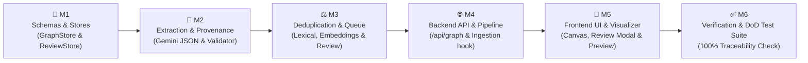

# Implementation Plan — Development Roadmap (Phase 2)
> **The order of development, milestones, tasks, and Definition of Done verification**

---

## Milestones

---

## Task Breakdown

### M1 — Schemas & File-Backed Stores (Backend Core)
- [ ] Define graph data types in `backend/src/types/graph.ts` (`EntityNode`, `ClaimNode`, `RelationshipEdge`, `EvidenceRef`, `ReviewQueueItem`).
- [ ] Implement `GraphStore.ts` in `backend/src/store/GraphStore.ts`:
  - Atomic file writes to `data/graph.json` with temporary file renaming and Windows EPERM retry.
  - CRUD operations: `addEntity()`, `addEdge()`, `addClaim()`, `mergeEntities()`, `getEntity()`, `getAll()`.
  - In-memory fast adjacency index (`Map<entityId, edgeIds>`).
- [ ] Implement `ReviewStore.ts` in `backend/src/store/ReviewStore.ts`:
  - Atomic persistence to `data/review_queue.json`.
  - Enqueue candidate, update status, list pending items.
- [ ] Unit tests for `GraphStore` and `ReviewStore` persistence and edge repointing.

---

### M2 — Extraction Engine & Provenance Validator (DoD Anchor)
- [ ] Implement `ProvenanceValidator.ts` in `backend/src/services/ProvenanceValidator.ts`:
  - Strict substring matching of `exactQuote` inside `chunk.text`.
  - Extraction of byte/char offsets and synthesis of `EvidenceRef` containing `{ docId, filename, page, slide, sheet, rowStart, lineStart, exactQuote }`.
  - Rejection / quarantine logic for ungrounded assertions.
- [ ] Implement `GraphExtractionService.ts` in `backend/src/services/GraphExtractionService.ts`:
  - Prompt engineering with Gemini structured JSON output (`responseSchema`).
  - Few-shot examples enforcing academic concept boundaries, claim classification, and exact quote attribution.
  - Mock extractor fallback for offline/test environments.
- [ ] Unit test: Verify that 100% of generated relations contain an `EvidenceRef` whose `exactQuote` is identical to a substring in the input text.

---

### M3 — Deduplication Engine & Review Queue Engine
- [ ] Implement `DeduplicationService.ts` in `backend/src/services/DeduplicationService.ts`:
  - Lexical normalizer (case, punctuation, whitespace, common abbreviations).
  - Acronym resolution (e.g. matching "Principal Component Analysis" with "PCA").
  - Semantic vector comparison using cosine similarity over `EmbeddingService` embeddings.
  - Tri-state router: Auto-merge ($\ge 0.92$), Queue for review ($0.78 - 0.92$), New Entity ($< 0.78$).
- [ ] Implement `ReviewQueueService.ts` in `backend/src/services/ReviewQueueService.ts`:
  - Resolving review candidates (`merge`, `separate`, `redirect`).
  - Atomic alias consolidation and edge repointing upon merge.
- [ ] Unit tests: Deduplication of known aliases ("SVD" vs "Singular Value Decomposition") and boundary testing for the uncertain review queue.

---

### M4 — Backend API Routes & Ingestion Integration
- [ ] Implement `backend/src/routes/graph.ts`:
  - `GET /api/graph` (returns active nodes, edges, and evidence summary).
  - `GET /api/graph/entities/:id` (detailed entity neighborhood).
  - `GET /api/graph/review-queue` (pending matches).
  - `POST /api/graph/review-queue/:id/resolve` (merge/separate resolution).
  - `POST /api/graph/reindex` (extract graph from already ingested documents).
- [ ] Wire Phase 2 extraction into `backend/src/routes/upload.ts`:
  - In the background SSE pipeline, trigger graph extraction after chunking & embedding: `Saving → Extracting → Chunking → Embedding → Graph Extracting → Done`.
- [ ] Add automatic background backfill on server startup in `backend/src/index.ts`:
  - Reload `graph.json` and `review_queue.json`.
  - Scan `metadata.json` for any ingested documents lacking graph extraction and extract them in the background without blocking server startup.

---

### M5 — Frontend UI, Graph Visualizer & Review Queue Modal
- [ ] Add API client functions in `frontend/src/api/client.ts`: `fetchGraph()`, `fetchReviewQueue()`, `resolveReviewItem()`.
- [ ] Create Zustand `graphStore.ts` for managing loaded graph entities, edges, filters, and review queue counts.
- [ ] Build **View Mode Selector** in the app header (`Chat` vs `Graph` mode, plus a badge button for pending review items).
- [ ] Implement **`GraphCanvas.tsx`**:
  - React Flow (`@xyflow/react`) canvas with custom optimized node and edge renderers.
  - Node color by type (`Concept`, `Method`, `Formula`, `Theorem`).
  - Edge labels displaying relation types (`PREREQUISITE_FOR`, `DEFINES`, `CONTRADICTS`).
  - Provisional nodes with dashed borders and 'Unreviewed' status badges.
  - Selecting any node or edge automatically updates `previewChunk` and triggers `PreviewPanel` to show the verbatim source passage.
- [ ] Implement **`ReviewQueueModal.tsx`**:
  - Modal displaying side-by-side card comparison between candidate entity and existing entity.
  - Highlights source quotes from both documents.
  - One-click buttons: "Merge & Consolidate Aliases" and "Keep Separate".
- [ ] Implement **Hybrid Chat Graph Integration**:
  - Augmented prompt in `LLMService` including 1-hop connected graph relationships.
  - Chat responses render interactive relation chips `[🔗 A → USES → B]` that open the source preview panel with verbatim evidence.

---

### M6 — Verification & Definition of Done Test Suite
- [ ] **DoD Verification Test**:
  - Write automated test script `backend/test/integration/provenance.test.ts`.
  - Ingest multi-format documents (PDF, DOCX, Markdown).
  - Extract entire knowledge graph.
  - Assert that `edges.every(edge => edge.evidence && edge.evidence.exactQuote && edge.evidence.docId)` strictly evaluates to `true`.
  - Assert that for every edge, `sourceDocText.includes(edge.evidence.exactQuote)` evaluates to `true`.
- [ ] End-to-end integration test verifying that merging an entity in the review queue correctly repoints edges and consolidates evidence.
- [ ] Run full monorepo build (`pnpm build`) and unit test suite (`pnpm test`).
