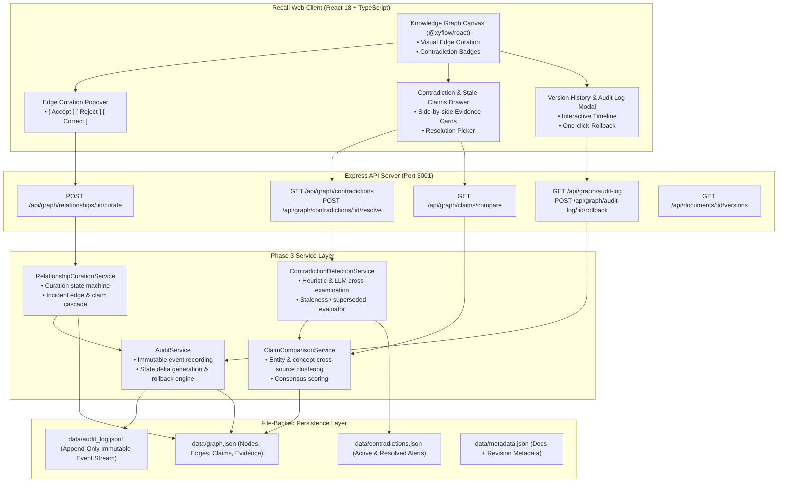
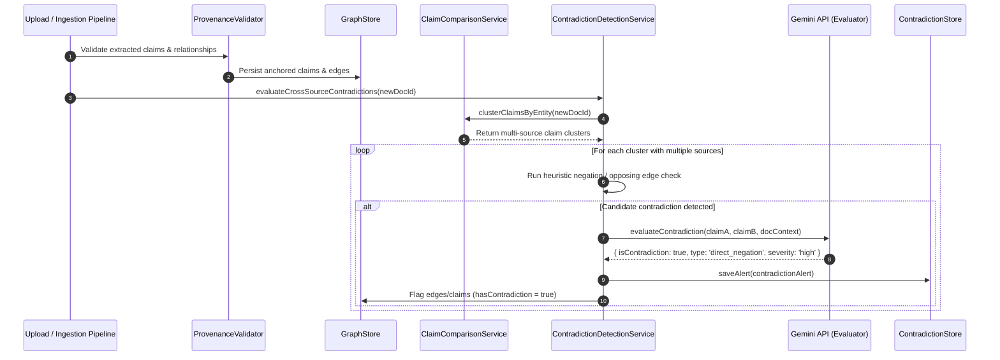
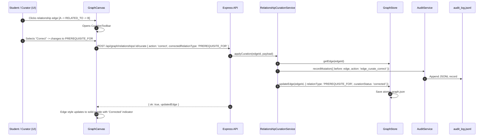
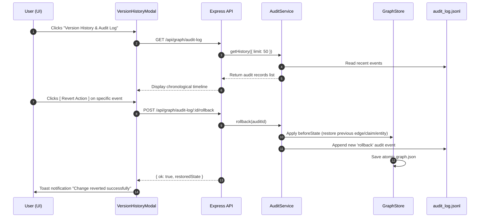

# Architecture Design — Software / System Architecture (Phase 3)
> **System components, sequence interactions, data flows, and storage design for cross-source comparison, contradiction detection, relationship curation, and audit versioning**

---

## Component Diagram

---

## Detailed Sequence Diagrams

### 1. Cross-Source Contradiction & Staleness Detection Sequence

---

### 2. Relationship Curation (Accept / Reject / Correct) Sequence

---

### 3. Audit Trail Inspection & Rollback Sequence

---

## Data Flow & Storage Architecture

1. **Graph Store Persistence (`data/graph.json`)**:
   - Atomic file swap (`fs.writeFileSync` to `.tmp` file, followed by `fs.renameSync` with exponential retry for Windows file locks).
   - In-memory indices:
     - `Map<entityId, Set<edgeId>>` for fast traversal.
     - `Map<curationStatus, Set<edgeId>>` for sub-millisecond filtering by status (`verified`, `rejected`, `proposed`, `corrected`).
2. **Contradiction Persistence (`data/contradictions.json`)**:
   - Stores active and dismissed contradiction alerts with evidence links.
3. **Immutable Audit Stream (`data/audit_log.jsonl`)**:
   - Append-only newline-delimited JSON stream.
   - Every line contains a cryptographic or UUID identifier, ISO timestamp, actor, action name, target type/ID, and explicit `beforeState` and `afterState` JSON objects.
   - Guarantees complete recovery and historical state replay without modifying historical log lines.
