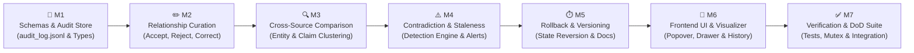

# Implementation Plan — Development Roadmap (Phase 3)
> **Development sequence, milestones, task breakdown, and verification criteria for Phase 3**

---

## Milestones

---

## Task Breakdown

### M1 — Data Models & Append-Only Audit Store (Backend Core)
- [ ] Create domain type definitions in `backend/src/types/contradiction.ts` (`ContradictionAlert`, `ClaimComparisonCluster`, `ContradictionResolution`).
- [ ] Create domain type definitions in `backend/src/types/audit.ts` (`AuditLogEntry`, `MutationAction`).
- [ ] Extend `backend/src/types/graph.ts` with `CurationStatus` (`'proposed' | 'verified' | 'rejected' | 'corrected'`), `curatedAt`, `originalRelationType`, and `hasContradiction`.
- [ ] Implement `AuditStore.ts` in `backend/src/store/AuditStore.ts`:
  - Append-only newline-delimited stream to `data/audit_log.jsonl`.
  - In-memory reverse index for fast chronological pagination and filtering by `targetId`.
- [ ] Unit tests for `AuditStore` (write, read, query, serialization integrity).

---

### M2 — Relationship Curation Engine & State Machine
- [ ] Implement `RelationshipCurationService.ts` in `backend/src/services/RelationshipCurationService.ts`:
  - `acceptEdge(edgeId, reason)`: Transition to `verified`, record timestamp, append audit log entry.
  - `rejectEdge(edgeId, reason)`: Transition to `rejected`, remove from active traversals, append audit log entry.
  - `correctEdge(edgeId, params)`: Re-type relation, invert direction, update description, preserve `originalRelationType`, append audit log entry.
- [ ] Expose REST route `POST /api/graph/relationships/:id/curate` in `backend/src/routes/curation.ts`.
- [ ] Update `GraphStore.ts` to support curation status queries (`filter(e => e.curationStatus !== 'rejected')`).
- [ ] Unit tests for edge curation transitions and audit generation.

---

### M3 — Cross-Source Claim Comparison & Alignment
- [ ] Implement `ClaimComparisonService.ts` in `backend/src/services/ClaimComparisonService.ts`:
  - Query all claims for a given canonical entity across distinct `docId`s.
  - Cluster claims by topic similarity using cosine distance over `EmbeddingService` vectors.
  - Calculate consensus score $C \in [0.0, 1.0]$ based on semantic alignment.
- [ ] Expose REST endpoint `GET /api/graph/claims/compare` in `backend/src/routes/curation.ts`.
- [ ] Unit tests: Comparing matching claims vs disparate claims across mock multi-document datasets.

---

### M4 — Contradiction & Staleness Detection Engine
- [ ] Implement `ContradictionStore.ts` in `backend/src/store/ContradictionStore.ts`:
  - Atomic persistence to `data/contradictions.json`.
- [ ] Implement `ContradictionDetectionService.ts` in `backend/src/services/ContradictionDetectionService.ts`:
  - Heuristic pre-filter (antonym keywords, negation syntax, opposing edge types e.g. `CAUSES` vs `PREVENTS`).
  - Structured Gemini prompt for nuanced factual/numeric contradictions.
  - Fallback mock contradiction evaluator for offline/testing runs.
  - Staleness evaluation comparing document timestamps and edition markers.
- [ ] Expose REST endpoints:
  - `GET /api/graph/contradictions` (list pending/resolved alerts).
  - `POST /api/graph/contradictions/:id/resolve` (apply human resolution: prefer A, prefer B, or context exception).
- [ ] Hook into `routes/upload.ts` to trigger contradiction evaluation in the background after document ingestion.
- [ ] Unit tests for contradiction detection and resolution.

---

### M5 — Rollback & Document Revision Tracking
- [ ] Implement rollback logic in `AuditService.ts`:
  - Given an `auditId`, fetch the entry and its `beforeState`.
  - Atomically re-apply `beforeState` to `GraphStore` / `ContradictionStore`.
  - Append an inverse `rollback` entry to `audit_log.jsonl` with `rollbackRefId`.
- [ ] Expose REST endpoint `POST /api/graph/audit-log/:id/rollback`.
- [ ] Add revision tracking to `metadataStore`: support `parentDocId` and auto-incrementing document `version`.
- [ ] Unit tests: Multi-step mutation followed by step-by-step rollback restoring identical graph topology.

---

### M6 — Frontend UI: Curation Popover, Contradiction Drawer & History Modal
- [ ] **Canvas Curation & Styling**:
  - Update `frontend/src/components/Graph/RelationEdge.tsx` with dynamic styles:
    - Dashed slate for `proposed`.
    - Thick solid emerald with check icon for `verified`.
    - Indigo solid line with edit icon for `corrected`.
    - Faded strike-through for `rejected`.
    - Pulsing rose for `hasContradiction`.
  - Build `RelationCurationPopover.tsx` providing one-click `[ Accept ]`, `[ Reject ]`, and `[ Correct ]` buttons upon clicking an edge.
  - Build `CorrectRelationModal.tsx` allowing dropdown selection of `RelationType`, direction toggle, and reason note.
- [ ] **Contradiction Drawer**:
  - Build `ContradictionDrawer.tsx` sliding open from the right when the `[ ⚠️ Contradictions (N) ]` header chip is clicked.
  - Side-by-side evidence cards highlighting the exact conflicting quotes in their respective source documents.
  - Action buttons: "Prefer Source A", "Prefer Source B", "Both Valid (Different Context)".
- [ ] **Version History & Audit Modal**:
  - Build `VersionHistoryModal.tsx` displaying the chronological timeline of graph changes.
  - Interactive "Revert This Action" button invoking the rollback API with visual feedback.
- [ ] **Chat Header Integration**:
  - Update `ChatHeaderWithViewSelector.tsx` to surface contradiction count badge and History button.

---

### M7 — Verification & Definition of Done Test Suite
- [ ] Vitest integration suite: `backend/test/integration/curation.test.ts`.
- [ ] Vitest integration suite: `backend/test/integration/contradictions.test.ts`.
- [ ] Vitest integration suite: `backend/test/integration/audit_rollback.test.ts`.
- [ ] Full end-to-end build verification: `pnpm build` across backend and frontend.

---

## Testing Definition of Done

1. **Relationship Curation**:
   - Ingest a document → select an edge on the graph canvas.
   - Click "Accept" → verify edge updates to `verified` state (solid emerald).
   - Click "Correct" → change type to `PREREQUISITE_FOR` → verify edge updates to `corrected` state.
   - Click "Reject" → verify edge is hidden or dimmed.
2. **Audit Logging & Rollback**:
   - Open **Version History** → verify each action is listed in the chronological ledger with timestamp and diff.
   - Click "Revert This Action" on the rejected edge → verify the edge is restored to its exact previous state.
3. **Cross-Source Contradiction Detection**:
   - Ingest two documents with opposing claims (e.g. Doc A: "Greedy choice is optimal for Fractional Knapsack", Doc B: "Greedy choice is suboptimal for 0/1 Knapsack").
   - Verify that the system flags the contradiction with a `⚠️ Contradiction` badge.
   - Open Contradiction Drawer → verify side-by-side comparative quotes are displayed with document names and page numbers.
   - Resolve with "Both Valid" → verify contradiction alert is dismissed and logged to audit trail.
4. **Stale Information Flagging**:
   - Ingest an older version and a revised version of notes → verify superseded claims receive the `⏳ Stale` badge.
