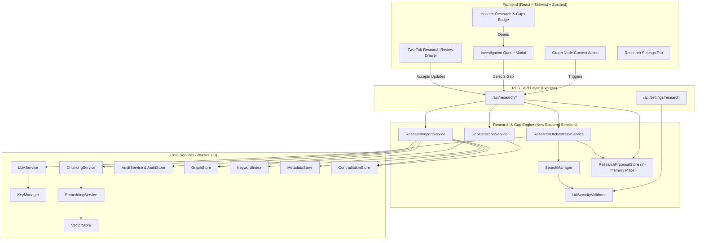
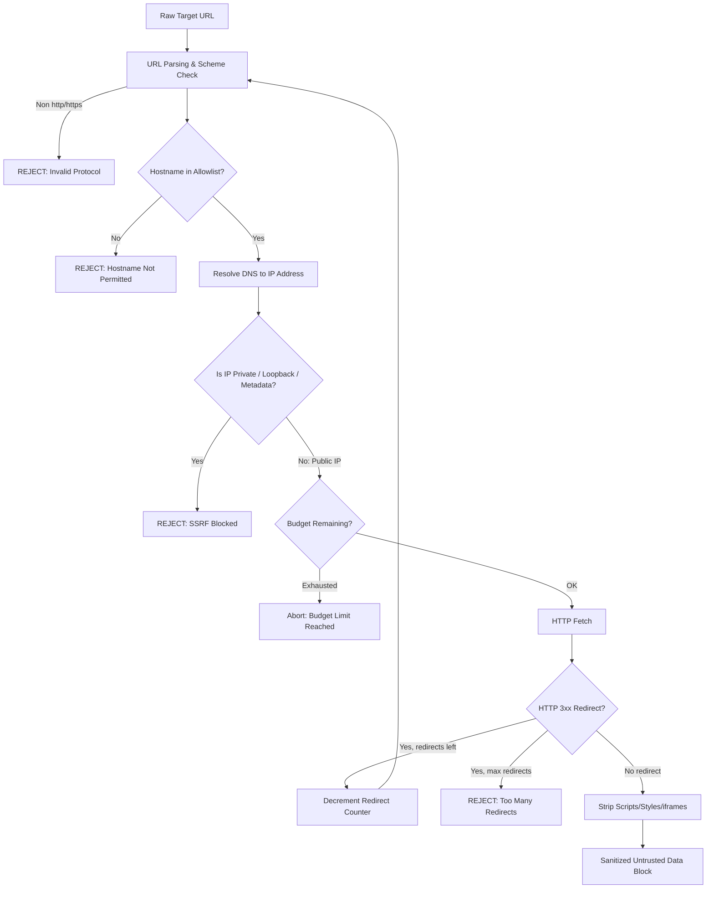

# System Architecture — Software & Data Architecture (Phase 4)
> **Autonomous Research Agent, Gap Investigation & Bounded Web Discovery**

---

## 1. High-Level System Architecture

The Phase 4 architecture introduces a dedicated **Autonomous Research & Gap Resolution Subsystem** that connects the existing evidentiary knowledge graph and vector stores with bounded external knowledge discovery.



---

## 2. End-to-End Interaction & Lifecycle Sequence

```mermaid
sequenceDiagram
    autonumber
    actor User
    participant Frontend as Frontend UI
    participant API as /api/research
    participant GapService as GapDetectionService
    participant Orchestrator as ResearchOrchestrator
    participant Security as UrlSecurityValidator
    participant Search as SearchManager
    participant LLM as LLMService
    participant PStore as ResearchProposalStore
    participant Importer as ResearchImportService
    participant GraphStore as GraphStore
    participant Meta as MetadataStore
    participant Chunker as ChunkingService
    participant Embedder as EmbeddingService
    participant Vec as VectorStore
    participant KW as KeywordIndex
    participant Audit as AuditService

    Note over User,Audit: 1. Gap Discovery & Question Formulation
    Frontend->>API: GET /api/research/gaps
    API->>GapService: detectGaps()
    GapService->>GraphStore: getAll() — nodes, edges, claims
    GapService->>Meta: getAll() — document metadata for staleness
    GraphStore-->>GapService: Graph topology data
    GapService-->>API: Ranked InvestigationGap[] list
    API-->>Frontend: Display badge count

    Note over User,Audit: 2. Bounded Research Task Execution
    User->>Frontend: Clicks "Investigate" on a gap
    Frontend->>API: POST /api/research/investigate { question, gapId }
    API->>Orchestrator: executeTask(prompt, budget)
    Orchestrator->>LLM: Formulate targeted search queries (max 3)
    LLM-->>Orchestrator: Search query strings

    loop For each query (bounded by budget)
        Orchestrator->>Search: Execute search (DDG / Wiki / arXiv)
        Search->>Security: validateUrl(targetUrl)
        alt Blocked
            Security-->>Search: REJECTED (domain or SSRF)
        else Allowed
            Security-->>Search: ALLOWED
            Search-->>Orchestrator: Cleaned text & metadata
        end
        Note right of Orchestrator: Decrement budget counters
    end

    Note over User,Audit: 3. Report Synthesis & Proposal Creation
    Orchestrator->>LLM: Synthesize report + extract proposed updates
    LLM-->>Orchestrator: SourcedResearchReport & candidates
    Orchestrator->>Orchestrator: Verify verbatim quotes exist in source text
    Orchestrator->>PStore: Store ResearchProposal (PENDING_REVIEW)
    Orchestrator-->>API: { proposalId, proposal }
    API-->>Frontend: Open Research Review Drawer

    Note over User,Audit: 4. Human-in-the-Loop Review & Import
    User->>Frontend: Reviews report; toggles Accept/Reject on items
    User->>Frontend: Clicks [Import Accepted Updates]
    Frontend->>API: POST /api/research/import { proposalId, accepted* }
    API->>PStore: Retrieve proposal
    API->>Importer: importProposal(proposal, acceptedIds)

    Note over Importer,Audit: 4a. Create & Index Dossier Document
    Importer->>Importer: Generate research_<id>.md to uploads/
    Importer->>Meta: Register Document (sourceType: 'web')
    Importer->>Chunker: chunkText(dossierContent)
    Chunker-->>Importer: Chunk[]
    Importer->>Embedder: embedChunks(chunks)
    Embedder-->>Importer: EmbeddedChunk[]
    Importer->>Vec: addAll(vectorRecords)
    Importer->>KW: addDocument(docId, chunks)

    Note over Importer,Audit: 4b. Resolve & Commit Graph Updates
    Importer->>GraphStore: findEntityByName(name) for each proposed entity
    Importer->>GraphStore: addEntity() or updateEntity() + addEdge()
    Importer->>Audit: recordMutation(research_import event)
    Importer->>PStore: Mark proposal as IMPORTED
    Importer-->>API: { success, researchDocId, auditEventId }
    API-->>Frontend: Toast confirmation
```

---

## 3. Data Flow & Pipeline Architecture

### A. URL Security & SSRF Protection Flow



### B. Hybrid Knowledge Base Storage Model

When a research proposal is imported, the data flows into three layers:

1. **Document Layer** (`uploads/research_<id>.md`):
   - Contains the structured executive summary, full citations, and source URLs.
   - Registered in `MetadataStore` as a `Document` with `sourceType: 'web'`, `sourceUrl`, `retrievedAt`.
   - Processed through `ChunkingService` → `EmbeddingService` → inserted into `VectorStore` (embedding vectors) and `KeywordIndex` (BM25 text search).
   - Users can scope this document into RAG chat like any other library item.

2. **Knowledge Graph Layer** (`data/graph.json`):
   - New entities inserted via `GraphStore.addEntity()` (after dedup name resolution).
   - New relationship edges inserted via `GraphStore.addEdge()` with standard `EvidenceRef`:
     ```typescript
     {
       docId: 'research_<id>',      // matches the dossier Document.docId
       chunkId: '<docId>-<chunkIndex>',
       filename: 'research_<id>.md',
       exactQuote: 'verbatim substring from source text',
       // page, slide, sheet are omitted for web dossiers
     }
     ```
   - All edges start with `curationStatus: 'proposed'` per existing GraphStore convention.

3. **Audit Trail Layer** (`data/audit_log.jsonl`):
   - An immutable `AuditLogEntry` with `action: 'research_import'` and `targetType: 'research'`.
   - `beforeState` captures the pre-import graph slice (entities/edges that will be modified).
   - `afterState` captures all new entities, edges, and the dossier document ID.
   - Calling rollback restores prior graph topology, removes the dossier from `MetadataStore`, and un-indexes its chunks from `VectorStore` and `KeywordIndex`.

---

## 4. Key Architectural Patterns & Invariants

| Invariant | Implementation Mechanism | Enforcement |
|-----------|--------------------------|-------------|
| **SSRF Zero-Trust** | Pre-flight DNS resolution before fetch + redirect loop validation | Hard failure if destination IP is non-public, cloud metadata, or hostname is not allowlisted |
| **Budget Ceiling** | `ResearchBudget` object threaded through all search methods | Synchronous count decrements; task gracefully finalizes if query, source, or time budget exhausts |
| **Strict Grounding** | Verbatim substring verification on retrieved web source text | Proposed entities/relations without exact `evidenceQuote` present in `ResearchSource.fullText` are automatically dropped before staging |
| **Entity Name Resolution** | `GraphStore.findEntityByName()` + `normalizeName()` | Prevents duplicate entity insertion; new entities only created if no normalized name/alias match exists |
| **Human-in-the-Loop** | Updates remain in `ResearchProposalStore` (in-memory) until user imports | Zero automatic graph mutations without explicit user consent |
| **Proposal Isolation** | `ResearchProposalStore` is a separate in-memory Map, not `ReviewStore` | No collision with Phase 2 entity dedup review queue |
| **Pipeline Reuse** | Dossier ingestion reuses `ChunkingService` → `EmbeddingService` → `VectorStore` pipeline | Identical indexing quality to user-uploaded documents |
| **Atomic Reversibility** | Compound rollback handler in extended `AuditService` | Reverting `research_import` atomically cleans graph elements, document metadata, and all vector/keyword index entries |
