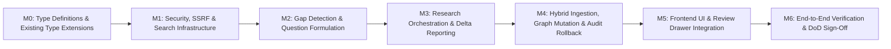

# Implementation Plan & Roadmap (Phase 4)
> **Autonomous Research Agent, Gap Investigation & Bounded Web Discovery**

---

## 1. Milestone Sequence Diagram



---

## 2. Sequenced Task Checklist

### Milestone 0: Type Definitions & Existing Type Extensions
> *Prerequisite: All downstream services import from these type definitions.*

- [ ] **M0.1**: Create `backend/src/types/research.ts` with all Phase 4 interfaces:
  - `GapType`, `InvestigationGap`, `ResearchSource`, `SourcedResearchReport`
  - `ProposedEntity`, `ProposedRelation`, `ProposedContradictionResolution`
  - `ResearchProposal` (with `id` field), `ResearchBudget`, `ResearchSettings`
- [ ] **M0.2**: Modify `backend/src/types/audit.ts`:
  - Add `'research_import'` to `AuditActionType` union.
  - Add `'research'` to `AuditTargetType` union.
- [ ] **M0.3**: Modify `backend/src/types/index.ts`:
  - Extend `Document` interface with optional fields: `sourceType?: 'upload' | 'web'`, `sourceUrl?: string`, `retrievedAt?: string`.
  - Add `export * from './research';` re-export.
- [ ] **M0.4**: Modify `frontend/src/types/index.ts`:
  - Mirror `Document` extension (`sourceType`, `sourceUrl`, `retrievedAt`).
  - Add frontend-side Phase 4 types (`InvestigationGap`, `ResearchProposal`, `ProposedEntity`, `ProposedRelation`, `ProposedContradictionResolution`, `SourcedResearchReport`, `ResearchSource`).
- [ ] **M0.5**: Verify both projects compile cleanly:
  ```bash
  pnpm --prefix backend build
  pnpm --prefix frontend build
  ```

### Milestone 1: Security, SSRF & Search Infrastructure
> *Foundation: All web access goes through these validated, budget-enforced services.*

- [ ] **M1.1**: Implement `backend/src/services/UrlSecurityValidator.ts`:
  - `isDomainAllowed(hostname)`: Exact match and suffix match against allowlist. Wildcard support for `*.edu`, `*.gov`.
  - `isPrivateOrReservedIp(ip)`: Block RFC 1918 (`10.0.0.0/8`, `172.16.0.0/12`, `192.168.0.0/16`), loopback (`127.0.0.0/8`, `::1`), link-local (`169.254.0.0/16`, `fe80::/10`), carrier-grade NAT (`100.64.0.0/10`), and cloud metadata (`169.254.169.254`).
  - `validateUrl(rawUrl)`: Scheme check (http/https only) → hostname allowlist check → DNS resolution → IP range check. Returns `{ valid, reason, resolvedIp }`.
  - `sanitizeHtml(html)`: Strip `<script>`, `<style>`, `<iframe>`, `<noscript>`, `<object>`, `<embed>` tags; extract body text content.
  - Default allowlist loaded from `data/research_settings.json` (fallback to hardcoded defaults).
- [ ] **M1.2**: Implement `backend/src/services/SearchManager.ts`:
  - `searchDuckDuckGo(query, budget)`: Fetch DuckDuckGo HTML/Lite, parse result links, validate each via `UrlSecurityValidator`, decrement `budget.queriesUsed`.
  - `fetchWikipediaSummary(title, budget)`: Call `https://en.wikipedia.org/api/rest_v1/page/summary/{title}`, decrement `budget.sourcesFetched`, return `ResearchSource`.
  - `searchArxiv(query, budget, maxResults)`: Call `http://export.arxiv.org/api/query`, parse XML response for titles, abstracts, authors, dates, decrement budget counters.
  - `safeFetchWebPage(url, budget)`: Full pre-flight validation, redirect following (max 3 per URL), HTML sanitization, budget decrement, returns `ResearchSource | null`.
  - All methods check `budget.startTimeMs + budget.maxExecutionTimeMs` against `Date.now()` before proceeding.
- [ ] **M1.3**: Author unit tests in `backend/test/unit/UrlSecurityValidator.test.ts`:
  - Test allowlist matching: `wikipedia.org` matches, `en.wikipedia.org` matches (suffix), `evil-wikipedia.org` rejects.
  - Test wildcard: `mit.edu` matches `*.edu`, `stanford.edu` matches, `fake.edu.evil.com` rejects.
  - Test SSRF blocking: `127.0.0.1`, `10.0.0.1`, `192.168.1.1`, `172.16.0.1`, `169.254.169.254`, `100.64.0.1`, `::1`, `localhost` all rejected.
  - Test scheme validation: `ftp://`, `file://`, `javascript:` all rejected.
  - Test HTML sanitization: scripts and iframes stripped, text content preserved.
- [ ] **M1.4**: Author unit tests in `backend/test/unit/SearchManager.test.ts`:
  - Mock HTTP responses for DuckDuckGo, Wikipedia, arXiv.
  - Verify budget decrements (queriesUsed, sourcesFetched).
  - Verify execution aborts cleanly when budget exhausted (returns partial results, no throw).
  - Verify blocked URLs are skipped without crashing.
- [ ] **M1.5**: Run tests and confirm green:
  ```bash
  pnpm --prefix backend test backend/test/unit/UrlSecurityValidator.test.ts --run
  pnpm --prefix backend test backend/test/unit/SearchManager.test.ts --run
  ```

### Milestone 2: Gap Detection & Question Formulation Engine
> *Depends on M0 (types) only. No web access needed.*

- [ ] **M2.1**: Implement `backend/src/services/GapDetectionService.ts`:
  - `findUnresolvedContradictions()`: Query `ContradictionStore.getAll()`, filter `status === 'active'`, create `InvestigationGap` with `type: 'CONTRADICTION'`, `priorityScore: 0.90-0.99` based on `severity`.
  - `findStaleClaims()`: Scan `GraphStore.getAllClaims()`, find `ClaimNode` with `isStale: true`, create gaps with `type: 'STALE_CLAIM'`, `priorityScore: 0.60-0.80`.
  - `findIsolatedEntities(minDegree = 2)`: For each active `EntityNode`, count non-rejected edges (incoming + outgoing), flag entities with degree < `minDegree`, `type: 'ISOLATED_ENTITY'`, `priorityScore: 0.30-0.50`.
  - `findSingleSourceClaims()`: Group claims by `subjectEntityId`, check if all claims for an entity reference the same `evidence.docId`, `type: 'WEAK_GROUNDING'`, `priorityScore: 0.40-0.60`.
  - `detectGaps()`: Aggregate all heuristics, deduplicate by entity, sort by `priorityScore` descending.
  - `formulateQuestionForGap(gap)`: Generate a natural-language research prompt from gap metadata (entity names, contradiction text, claim subject).
- [ ] **M2.2**: Create `backend/src/store/ResearchProposalStore.ts`:
  - In-memory `Map<string, ResearchProposal>`.
  - `set(proposal)`, `get(id)`, `delete(id)`, `getAll()`.
  - `cleanup()`: Remove proposals older than 30 minutes (called lazily on `get`/`getAll`).
- [ ] **M2.3**: Create `backend/src/routes/research.ts`:
  - `GET /api/research/gaps` → calls `gapDetectionService.detectGaps()`, returns `{ gaps, totalCount }`.
  - Stub `POST /api/research/investigate`, `POST /api/research/import`, `POST /api/research/reject`, `GET /api/research/proposals/:id` (wired in M3/M4).
- [ ] **M2.4**: Modify `backend/src/index.ts`: Import and mount `researchRouter` at `/api/research`.
- [ ] **M2.5**: Author tests in `backend/test/unit/GapDetectionService.test.ts`:
  - Create mock graph with known orphan entities, stale claims, active contradictions, single-source entities.
  - Verify correct detection and priority ranking.
  - Verify question formulation produces coherent prompts.
- [ ] **M2.6**: Run tests:
  ```bash
  pnpm --prefix backend test backend/test/unit/GapDetectionService.test.ts --run
  ```

### Milestone 3: Research Orchestration & Sourced Delta Reporting
> *Depends on M1 (SearchManager) and M2 (GapDetectionService, ProposalStore).*

- [ ] **M3.1**: Implement `backend/src/services/ResearchOrchestratorService.ts`:
  - `executeTask(prompt, options)`:
    1. Initialize `ResearchBudget` from options or defaults from `data/research_settings.json`.
    2. Call `LLMService` to formulate up to `budget.maxQueries` targeted search query strings from the prompt. Use prompt injection defense in the system instruction.
    3. For each query, call `SearchManager.searchDuckDuckGo()`, `fetchWikipediaSummary()`, and/or `searchArxiv()` based on enabled providers. Respect budget counters.
    4. Collect all `ResearchSource[]`.
    5. Wrap all source text in `<UNTRUSTED_EXTERNAL_DATA>` delimiters. Call `LLMService` to synthesize a `SourcedResearchReport` (summary, detailedAnalysis, whatChangedAndWhy) and extract `ProposedEntity[]` and `ProposedRelation[]`.
    6. Call `verifyVerbatimEvidence()` — drop any proposed item whose `evidenceQuote` is NOT a substring of its referenced `ResearchSource.fullText`.
    7. Create `ResearchProposal` with `status: 'PENDING_REVIEW'`, store in `ResearchProposalStore`.
    8. Return the proposal.
  - Graceful degradation: If budget exhausts with partial sources, still synthesize a report from available data. If zero sources retrieved, return an error-state proposal with empty candidates.
- [ ] **M3.2**: Wire `POST /api/research/investigate` in `research.ts`:
  - Validate request body (`question` required).
  - Call `researchOrchestratorService.executeTask()`.
  - Return `{ proposalId, proposal }` on success.
  - Return `408` if no useful sources found.
- [ ] **M3.3**: Wire `GET /api/research/proposals/:id`:
  - Look up proposal in `ResearchProposalStore`.
  - Return `404` if not found or expired.
- [ ] **M3.4**: Author integration tests in `backend/test/integration/ResearchOrchestrator.test.ts`:
  - Mock HTTP layer (DuckDuckGo, Wikipedia, arXiv responses with known text).
  - Verify `SourcedResearchReport` has non-empty summary, citations, and whatChangedAndWhy.
  - Verify proposed entities/relations have `evidenceQuote` that is a verbatim substring of source text.
  - Verify budget enforcement: with `maxQueries: 1, maxSources: 2`, confirm exactly 1 query issued and ≤ 2 sources fetched.
  - Verify graceful degradation with zero results.
- [ ] **M3.5**: Run tests:
  ```bash
  pnpm --prefix backend test backend/test/integration/ResearchOrchestrator.test.ts --run
  ```

### Milestone 4: Hybrid Ingestion, Graph Mutation & Audit Rollback
> *Depends on M3 (proposals exist in ProposalStore). Core data integrity milestone.*

- [ ] **M4.1**: Implement `backend/src/services/ResearchImportService.ts`:
  - `importProposal(proposalId, acceptedEntityTempIds, acceptedRelationTempIds, acceptedResolutionIds)`:
    1. Retrieve proposal from `ResearchProposalStore`. Fail if not found or already imported.
    2. Filter to only accepted items.
    3. **Generate dossier document**: Create `uploads/research_<id>.md` with executive summary, sources, and evidence quotes formatted as markdown.
    4. **Register in MetadataStore**: `metadataStore.set({ docId, filename, mimeType: 'text/markdown', sourceType: 'web', sourceUrl, retrievedAt, ... })`.
    5. **Chunk and index**: `chunkingService.chunk(text, metadata)` → `embeddingService.embedChunks(chunks)` → `vectorStore.addAll(records)` + `keywordIndex.addDocument(docId, chunks)`.
    6. **Entity name resolution**: For each accepted `ProposedEntity`, call `graphStore.findEntityByName(name)`. If match found, augment existing entity's evidence. If no match, insert new `EntityNode` via `graphStore.addEntity()`.
    7. **Edge insertion**: For each accepted `ProposedRelation`, resolve source/target entity IDs via `graphStore.findEntityByName()`, call `graphStore.addEdge()` with `EvidenceRef { docId, chunkId, filename, exactQuote }` and `curationStatus: 'proposed'`.
    8. **Contradiction resolution**: For each accepted resolution, update `ContradictionStore` status from `'active'` to resolved.
    9. **Audit event**: Record a single `research_import` event in `AuditService` with `targetType: 'research'`, `targetId: proposalId`, `beforeState` (graph slice before), `afterState` (all new IDs and the dossier docId).
    10. **Finalize**: Mark proposal as `IMPORTED` in ProposalStore. Persist all stores.
- [ ] **M4.2**: Extend `backend/src/services/AuditService.ts` rollback for `research_import`:
  - In the `rollback()` method, add a handler for `action === 'research_import'`:
    1. Parse `afterState` to get `addedEntityIds`, `addedRelationIds`, `resolvedContradictionIds`, and `researchDocId`.
    2. Remove each added edge from `GraphStore` via `graphStore.removeEdge()`.
    3. Remove each added entity from `GraphStore` via `graphStore.removeEntity()` (only if it was newly created, not augmented).
    4. Un-index all chunks matching `docId` from `VectorStore` and `KeywordIndex`.
    5. Remove the document from `MetadataStore` via `metadataStore.delete(docId)`.
    6. Delete the file at `uploads/research_<id>.md`.
    7. Restore resolved contradictions to `'active'` status in `ContradictionStore`.
    8. Append `rollback` audit entry.
    9. Persist all modified stores.
- [ ] **M4.3**: Wire `POST /api/research/import` in `research.ts`:
  - Validate request body (`proposalId`, at least one accepted ID array).
  - Call `researchImportService.importProposal()`.
  - Return success response with counts.
- [ ] **M4.4**: Wire `POST /api/research/reject` in `research.ts`:
  - Mark proposal as `REJECTED` in ProposalStore, delete from memory.
  - Return `{ success: true }`.
- [ ] **M4.5**: Modify `backend/src/routes/settings.ts`:
  - Add `GET /api/settings/research` → read `data/research_settings.json` (with defaults fallback).
  - Add `PUT /api/settings/research` → validate and write to `data/research_settings.json`, call `urlSecurityValidator.updateAllowedDomains()`.
- [ ] **M4.6**: Author integration tests in `backend/test/integration/ResearchImport.test.ts`:
  - **Import test**: Create a mock proposal with known entities/relations. Call `importProposal()`. Verify:
    - Dossier file exists at `uploads/research_<id>.md`.
    - `MetadataStore` has entry with `sourceType: 'web'`.
    - `VectorStore` has chunks with matching `docId`.
    - `GraphStore` has new entities and edges with valid `EvidenceRef`.
    - Entity name dedup: if a proposed entity name matches an existing entity, no duplicate is created.
    - `AuditStore` has a `research_import` event.
  - **Rollback test**: Call `auditService.rollback(auditEventId)`. Verify:
    - Added entities and edges removed from `GraphStore`.
    - Chunks removed from `VectorStore`.
    - Document removed from `MetadataStore`.
    - File deleted from `uploads/`.
    - Contradictions restored to `active`.
    - Rollback audit entry appended.
- [ ] **M4.7**: Run tests:
  ```bash
  pnpm --prefix backend test backend/test/integration/ResearchImport.test.ts --run
  ```

### Milestone 5: Frontend UI & Review Drawer Integration
> *Depends on M4 (all backend APIs functional).*

- [ ] **M5.1**: Extend `frontend/src/store/appStore.ts`:
  - Add state: `researchGaps: InvestigationGap[]`, `activeProposal: ResearchProposal | null`, `isResearching: boolean`, `researchProgress`, `isQueueModalOpen`, `isReviewDrawerOpen`.
  - Add actions: `fetchResearchGaps()`, `startResearchTask()`, `importAcceptedUpdates()`, `rejectProposal()`, `setQueueModalOpen()`, `setReviewDrawerOpen()`, `clearActiveProposal()`.
- [ ] **M5.2**: Update `frontend/src/components/Header/ChatHeaderWithViewSelector.tsx`:
  - Add `[ 🔍 Gaps (N) ]` badge button using `researchGaps.length` for count.
  - Fetch gaps on component mount via `fetchResearchGaps()`.
  - Click handler opens `InvestigationQueueModal`.
- [ ] **M5.3**: Build `frontend/src/components/Research/InvestigationQueueModal.tsx`:
  - Tab filters: All Gaps, Contradictions, Stale, Missing Evidence.
  - Gap cards with priority score, entity names, suggested question, and `[ 🔍 Investigate ]` button.
  - Custom prompt text input at bottom with `[ 🔍 Start Task ]` button.
  - In-progress state: Show `ResearchProgressPanel` with budget counters, source discovery log, progress bar, and `[ Cancel Task ]`.
  - Error state: Show failure reason, actionable suggestions, and `[ Try Again ]` button.
  - Empty state: "No gaps detected" message with freeform input.
- [ ] **M5.4**: Build `frontend/src/components/Research/ResearchProgressPanel.tsx`:
  - Real-time budget counters (queries used/max, sources fetched/max, time remaining).
  - Source discovery log entries with domain validation status icons (✓ / ✗).
  - Cancel button.
- [ ] **M5.5**: Build `frontend/src/components/Research/ResearchReviewDrawer.tsx`:
  - Two-tab slide-over drawer (640px right panel):
    - **Tab 1 (Sourced Report)**: Executive summary, "What Changed & Why", source citation cards with domain pills and verbatim quote callouts.
    - **Tab 2 (Proposed Graph Updates)**: Interactive checkbox list of proposed entities (emerald chips), relations (blue chips), and contradiction resolutions (amber chips). `[ Select All ]` toggle. Inline `[ Edit ]` and `[ Edit Type ▾ ]` buttons. `[ Import Accepted Updates (N) ]` and `[ Discard All ]` footer buttons.
  - Close button (`X`) that prompts "Discard proposal?" if unsaved.
- [ ] **M5.6**: Build `frontend/src/components/Research/ResearchSettingsTab.tsx`:
  - Domain allowlist editor: Editable tag list with add/remove.
  - Budget controls: Number inputs for max queries, max sources, max execution time.
  - Provider toggles: DuckDuckGo, Wikipedia API, arXiv API checkboxes.
  - Save button → `PUT /api/settings/research`.
- [ ] **M5.7**: Modify existing components:
  - `GraphCanvas.tsx`: Add `[ 🔍 Investigate Gaps ]` to entity node right-click context menu.
  - `ContradictionDrawer.tsx`: Add `[ 🔍 Research Consensus ]` button to each active contradiction card.
  - `SettingsModal.tsx`: Add "Research & Sources" tab rendering `ResearchSettingsTab`.
  - `DocumentList.tsx` (Sidebar): Show 🌐 globe icon (Lucide `Globe` component) for documents with `sourceType === 'web'`.
  - `App.tsx`: Mount `<InvestigationQueueModal />` and `<ResearchReviewDrawer />` in the global modals/drawers section.
- [ ] **M5.8**: Verify frontend compiles cleanly:
  ```bash
  pnpm --prefix frontend build
  ```

### Milestone 6: End-to-End Verification & DoD Sign-Off
> *Full integration check across all milestones.*

- [ ] **M6.1**: Run full backend test suite:
  ```bash
  pnpm --prefix backend test --run
  ```
  - Target: **All existing Phase 1-3 tests still passing** + all new Phase 4 tests green.
- [ ] **M6.2**: Run full frontend production build:
  ```bash
  pnpm --prefix frontend build
  ```
  - Target: 0 errors, 0 TypeScript compiler failures.
- [ ] **M6.3**: Verify End-to-End Definition of Done:
  - [ ] Gap Detection: `GET /api/research/gaps` returns ranked gaps when graph has contradictions, orphan entities, and stale claims.
  - [ ] Bounded Search & Security: Research task never exceeds 3 queries and 5 sources. Private IPs and non-whitelisted domains are blocked (verified by unit tests).
  - [ ] Sourced Report: Investigation task produces a `SourcedResearchReport` with non-empty summary, citations, and "What Changed and Why".
  - [ ] Verbatim Grounding: Every proposed entity/relation has `evidenceQuote` that is a substring of the retrieved source text.
  - [ ] Human-in-the-Loop: Two-tab drawer displays report and interactive diff with individual Accept/Reject toggles.
  - [ ] Hybrid Ingestion: Importing creates a web dossier in `uploads/`, registers it in `MetadataStore` with `sourceType: 'web'`, indexes chunks, adds entities/edges to `GraphStore` with valid `EvidenceRef`, and writes an audit event.
  - [ ] Entity Dedup: Proposed entities matching existing graph entities by normalized name are merged, not duplicated.
  - [ ] Atomic Rollback: Rolling back a `research_import` audit event cleanly removes all added graph elements, the dossier document, and all indexed chunks.
  - [ ] Settings: Approved domains and budgets are configurable in the Settings modal and persisted to `data/research_settings.json`.
  - [ ] Library Integration: Web research documents appear with 🌐 icon in the sidebar and are queryable in RAG chat.
- [ ] **M6.4**: Commit and push to `origin/master`:
  ```bash
  git add -A
  git status
  git commit -m "feat: implement Phase 4 autonomous research agent, gap detection, bounded web discovery, and sourced research import"
  git push origin master
  ```

---

## 3. Automated Testing Commands

```bash
# 1. Run all backend tests (Phases 1-4)
pnpm --prefix backend test --run

# 2. Run specific Phase 4 unit tests
pnpm --prefix backend test backend/test/unit/UrlSecurityValidator.test.ts --run
pnpm --prefix backend test backend/test/unit/SearchManager.test.ts --run
pnpm --prefix backend test backend/test/unit/GapDetectionService.test.ts --run

# 3. Run specific Phase 4 integration tests
pnpm --prefix backend test backend/test/integration/ResearchOrchestrator.test.ts --run
pnpm --prefix backend test backend/test/integration/ResearchImport.test.ts --run

# 4. Compile and build backend & frontend
pnpm --prefix backend build
pnpm --prefix frontend build
```

---

## 4. Definition of Done (DoD) Verification Steps

| # | Checkpoint | Target State | Verification Method |
|---|------------|--------------|---------------------|
| 1 | **Gap Discovery** | System detects contradictions, orphan entities, stale claims, and single-source gaps | `GET /api/research/gaps` returns ranked gaps; header badge shows count. |
| 2 | **Bounded Search & Security** | Searches DuckDuckGo, Wikipedia, arXiv within allowlist; hard-blocks private IPs and non-approved domains | Unit tests for `127.0.0.1`, `10.0.0.1`, `169.254.169.254`, `evil.com` all blocked. Budget never exceeds 3 queries / 5 sources. |
| 3 | **Sourced Report** | Generates executive summary + "What changed and why" + verbatim evidence citations | Integration test verifies non-empty report fields and citation URLs. |
| 4 | **Verbatim Grounding** | Every proposed entity/relation evidence quote is a substring of source text | Orchestrator `verifyVerbatimEvidence()` drops ungrounded items; test confirms. |
| 5 | **Human-in-the-Loop Staging** | Two-tab drawer displays report and interactive diff with individual Accept/Reject | Frontend build passes; manual verification of drawer tabs and checkboxes. |
| 6 | **Entity Name Resolution** | Proposed entities matching existing graph entities are merged, not duplicated | Integration test: propose entity "Dijkstra's Algorithm" when it already exists → no duplicate `EntityNode` created. |
| 7 | **Hybrid Ingestion** | Imported research updates Knowledge Graph and creates searchable web dossier | Verify `MetadataStore` entry with `sourceType: 'web'`; verify `VectorStore` has chunks; verify `GraphStore` has new edges. |
| 8 | **Atomic Rollback** | Rolling back `research_import` cleanly reverts graph, document, and index | Integration test: rollback → verify entities/edges removed, chunks removed, doc removed, contradictions restored. |
| 9 | **Settings Persistence** | Approved domains and budgets configurable and persisted | `PUT /api/settings/research` → `GET /api/settings/research` returns updated values. |
| 10 | **Regression Safety** | All existing Phase 1-3 tests still pass | `pnpm --prefix backend test --run` → 374+ tests passing (Phase 1-3) + new Phase 4 tests. |

---

## 5. Decisions Log

| Decision | Rationale |
|----------|-----------|
| **In-memory `ResearchProposalStore`** instead of `ReviewStore` | `ReviewStore` is for Phase 2 entity dedup queue items (`ReviewQueueItem`). Research proposals are a different domain object. Using a separate in-memory store avoids schema collision and keeps proposals ephemeral (30-min TTL). |
| **Dossier stored in `uploads/`** instead of `data/documents/` | The existing upload pipeline saves files to `uploads/`. Using the same directory ensures `ChunkingService` and `EmbeddingService` work identically. No `data/documents/` directory exists in the codebase. |
| **`EvidenceRef` uses standard fields** (`docId`, `chunkId`, `filename`, `exactQuote`) instead of custom web-only fields | The existing `EvidenceRef` interface is deeply integrated across `GraphStore`, `ProvenanceValidator`, `LLMService`, and all frontend components. Adding non-standard fields (`sourceUrl`, `docType`) would break type compatibility. Instead, web provenance is tracked on the `Document` interface itself (`sourceType`, `sourceUrl`, `retrievedAt`). |
| **`AuditActionType` extended** with `'research_import'` instead of a separate schema | Reuses the existing `AuditService.rollback()` dispatch mechanism. Adding a new action type is a 1-line change to the union; the rollback handler gets a new `case` branch. |
| **Test files in `backend/test/unit/` and `backend/test/integration/`** | Follows the existing project test directory convention (`backend/test/unit/`, `backend/test/integration/`, `backend/test/e2e/`), NOT `backend/src/test/`. |
| **Entity name resolution before graph insertion** | `GraphStore.addEdge()` requires entity IDs, not names. The import service must resolve `ProposedRelation.sourceEntityName` → entity ID via `GraphStore.findEntityByName()` before insertion. This also prevents duplicate entity creation. |
